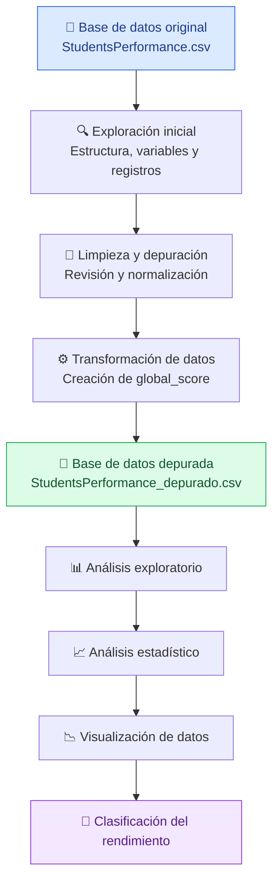

# 📊 Students Performance in Exams
### Análisis exploratorio y estadístico del rendimiento académico

## 1. Descripción del proyecto

Este proyecto analiza el rendimiento académico de una muestra de 1.000 estudiantes de secundaria de Estados Unidos, utilizando el conjunto de datos **Students Performance in Exams**, obtenido de Kaggle.

El objetivo principal es estudiar la posible relación entre diferentes factores personales, familiares y educativos y las calificaciones obtenidas por los estudiantes en tres competencias: Matemáticas, Lectura y Escritura.

El análisis aborda cuestiones como la relación entre el nivel educativo de los padres y el rendimiento académico, las diferencias entre hombres y mujeres, el contexto socioeconómico familiar y la posible asociación entre la preparación previa de los exámenes y las calificaciones.

Para ello, se desarrolla un proceso completo de análisis de datos que comprende la exploración inicial, la limpieza y transformación de la información, el análisis estadístico, la representación gráfica y la creación de nuevos indicadores.

## 2. Fuente y descripción de los datos

La información procede del conjunto de datos **Students Performance in Exams**, publicado en [Kaggle](https://www.kaggle.com/datasets/spscientist/students-performance-in-exams).

La base de datos contiene 1.000 registros y ocho variables originales:

| Variable | Descripción |
|---|---|
| `gender` | Género del estudiante. |
| `race_ethnicity` | Grupo étnico, clasificado en cinco categorías (A, B, C, D y E). |
| `parental_level_of_education` | Nivel educativo más alto alcanzado por uno de los progenitores. |
| `lunch` | Tipo de almuerzo escolar: tarifa estándar o gratuita/reducida. |
| `test_preparation_course` | Indica si el estudiante ha completado un curso de preparación. |
| `math_score` | Calificación obtenida en Matemáticas. |
| `reading_score` | Calificación obtenida en Lectura. |
| `writing_score` | Calificación obtenida en Escritura. |

Las tres competencias académicas se califican sobre 100 puntos.

La variable `lunch` se utiliza como indicador indirecto del contexto socioeconómico familiar, teniendo en cuenta que la modalidad de almuerzo gratuito o reducido está vinculada habitualmente a determinados criterios económicos.

## 3. Proceso de trabajo

El proyecto sigue un proceso estructurado que permite transformar los datos originales en información preparada para su análisis.



### 3.1. Exploración y limpieza de los datos

En primer lugar, se examina la estructura de la base de datos mediante Pandas, comprobando los tipos de variables, los registros disponibles y la existencia de valores ausentes.

Durante este proceso se identifica un aspecto que requiere normalización en la variable `test_preparation_course`: el valor `none` se sustituye por `not completed`, facilitando su interpretación y posterior utilización.

### 3.2. Creación de un indicador de rendimiento global

Se incorpora una nueva variable denominada `global_score`, que representa la media aritmética de las tres calificaciones obtenidas por cada estudiante.

Su cálculo se realiza mediante la siguiente expresión:

```python
sp["global_score"] = (
    sp["math_score"] +
    sp["reading_score"] +
    sp["writing_score"]
) / 3

sp["global_score"] = sp["global_score"].round(2)
```

Este indicador permite disponer de una medida conjunta del rendimiento académico de cada estudiante y utilizarla en los análisis posteriores.

### 3.3. Exportación de los datos depurados

Una vez completada la transformación, la nueva base de datos se guarda en formato CSV como `StudentsPerformance_depurado.csv`.

De esta manera, los análisis posteriores trabajan sobre una versión preparada y homogénea de la información original.

## 4. Análisis realizados

El proyecto se estructura en siete bloques de análisis, cada uno orientado a estudiar una dimensión diferente del rendimiento académico.

### Análisis 1. Rendimiento académico general

Se estudia el comportamiento de las calificaciones en Matemáticas, Lectura y Escritura, incorporando también el indicador de rendimiento global.

Se utilizan medidas estadísticas descriptivas:

- Media y mediana.
- Desviación típica.
- Valores mínimos y máximos.
- Cuartiles y percentiles.
- Distribución de las calificaciones.

También se utilizan diagramas de cajas (*boxplots*) y gráficos de barras para representar las distribuciones y comparar las puntuaciones medias.

Por último, se identifican dos perfiles de estudiantes:

- Bajo rendimiento: puntuaciones inferiores a 50 en las tres competencias simultáneamente.
- Alto rendimiento: puntuaciones superiores a 70 en las tres competencias simultáneamente.

Se examinan las características más frecuentes de ambos grupos.

### Análisis 2. Rendimiento académico según el género

Se comparan las calificaciones de hombres y mujeres en las tres competencias y en el indicador global.

El análisis incluye:

- Comparación de medias.
- Representación gráfica de las diferencias.
- Contraste de hipótesis mediante la prueba t de Student para muestras independientes.

Se establecen las siguientes hipótesis:

- **Hipótesis nula (H₀):** no existen diferencias entre las puntuaciones medias de ambos grupos.
- **Hipótesis alternativa (H₁):** existen diferencias entre las puntuaciones medias de ambos grupos.

Se utiliza un nivel de significación estadística de 0,05 y se aplica la versión de Welch de la prueba t, que no presupone igualdad de varianzas.

### Análisis 3. Rendimiento académico y contexto socioeconómico

Se utiliza la variable `lunch` para estudiar la posible relación entre el contexto socioeconómico familiar y las calificaciones.

Se comparan dos grupos:

- Estudiantes con almuerzo de tarifa estándar.
- Estudiantes con almuerzo gratuito o reducido.

Se analizan las diferencias en Matemáticas, Lectura, Escritura y rendimiento global mediante gráficos de comparación y pruebas t de Student para muestras independientes.

### Análisis 4. Rendimiento académico según el nivel educativo de los padres

Se estudia la relación entre la formación académica de los progenitores y el rendimiento de los estudiantes.

La variable contempla seis categorías:

1. Some high school.
2. High school.
3. Some college.
4. Associate's degree.
5. Bachelor's degree.
6. Master's degree.

El análisis incluye:

- Distribución de los estudiantes según el nivel educativo familiar.
- Comparación de las calificaciones medias por categoría.
- Representación de las diferencias mediante gráficos de barras.
- Diagramas de cajas para estudiar la distribución del rendimiento global en cada grupo.

### Análisis 5. Rendimiento académico y preparación previa

Se comparan los resultados de los estudiantes que han completado un curso de preparación para los exámenes con los de aquellos que no lo han realizado.

Se estudian las cuatro variables de rendimiento:

- Matemáticas.
- Lectura.
- Escritura.
- Rendimiento global.

Además de las representaciones gráficas, se aplican pruebas t de Student para muestras independientes, utilizando la corrección de Welch y un nivel de significación de 0,05.

### Análisis 6. Correlaciones entre competencias

Se estudia la relación estadística entre las calificaciones de Matemáticas, Lectura y Escritura.

Para ello, se calcula una matriz de correlaciones y se representa mediante un mapa de calor (*heatmap*).

Esta representación permite observar la intensidad y dirección de las relaciones entre las tres competencias.

### Análisis 7. Clasificación del rendimiento académico global

Se desarrolla una clasificación de los estudiantes utilizando la variable `global_score`.

Se establecen cuatro niveles de rendimiento:

| Nivel | Puntuación global |
|---|---:|
| Bajo | 0 – 49,99 |
| Medio | 50 – 69,99 |
| Alto | 70 – 84,99 |
| Excelente | 85 – 100 |

A partir de esta clasificación se estudia la distribución del alumnado en cada categoría.

También se examinan las características más frecuentes de los estudiantes pertenecientes a los grupos de menor y mayor rendimiento, utilizando variables como el género, el grupo étnico, el nivel educativo de los padres, el tipo de almuerzo y la preparación previa.


## 5. Herramientas y tecnologías utilizadas

El proyecto se desarrolla utilizando Python y Jupyter Notebook, con las siguientes bibliotecas:

| Herramienta | Aplicación |
|---|---|
| Python | Lenguaje de programación utilizado. |
| Jupyter Notebook | Desarrollo y documentación del análisis. |
| Pandas | Manipulación, limpieza y análisis de datos. |
| NumPy | Operaciones numéricas. |
| Matplotlib | Creación de gráficos y visualizaciones. |
| Seaborn | Representación estadística y mapas de calor. |
| SciPy | Contrastes estadísticos y pruebas de hipótesis. |

## 6. Estructura del repositorio

La organización del proyecto sigue una estructura que separa los cuadernos de trabajo, los datos y las representaciones gráficas.

```text
Students-Performance-in-Exams/
│
├── data/
│   ├── StudentsPerformance.csv
│   └── StudentsPerformance_depurado.csv
│
├── img/
│   ├── Grafico_1_1.jpg
│   ├── Grafico_1_2.jpg
│   ├── Grafico_1_3.jpg
│   ├── Grafico_1_4.jpg
│   ├── Grafico_2_1.jpg
│   ├── Grafico_3_1.jpg
│   ├── Grafico_4_1.jpg
│   ├── Grafico_4_2.jpg
│   ├── Grafico_4_3.jpg
│   ├── Grafico_5_1.jpg
│   ├── Grafico_6_1.jpg
│   └── Grafico_7_1.jpg
│
├── notebooks/
│   ├── 0_Memory.ipynb
│   ├── 1_Depuracion_base.ipynb
│   ├── 2_Análisis1.ipynb
│   ├── 3_Análisis2.ipynb
│   ├── 4_Análisis3.ipynb
│   ├── 5_Análisis4.ipynb
│   ├── 6_Análisis5.ipynb
│   ├── 7_Análisis6.ipynb
│   └── 8_Análisis7.ipynb
│
├── src/
│   ├── process/
│   │   ├── 1_Depuration.py
│   │   ├── 2_Analysis1.py
│   │   ├── 3_Analysis2.py
│   │   ├── 4_Analysis3.py
│   │   ├── 5_Analysis4.py
│   │   ├── 6_Analysis5.py
│   │   ├── 7_Analysis6.py
│   │   └── 8_Analysis7.py
│   ├── funciones.py
│   └── main.py
│
└── README.md
```

## 7. Instalación y ejecución

Para reproducir el proyecto es necesario disponer de Python y Jupyter Notebook.

### Instalación de las dependencias

Las bibliotecas necesarias pueden instalarse mediante el siguiente comando:

```bash
pip install pandas numpy matplotlib seaborn scipy jupyter
```

### Ejecución

1. Descargar o clonar el repositorio.
2. Instalar las dependencias indicadas.
3. Abrir Jupyter Notebook.
4. Acceder al archivo `0_Memory.ipynb`.
5. Ejecutar las celdas siguiendo el orden establecido.

Es necesario conservar las rutas relativas utilizadas en el notebook y disponer de los archivos CSV en la carpeta correspondiente.

## 8. Objetivo del proyecto

Este repositorio documenta un proceso de análisis de datos aplicado al ámbito educativo, desde la preparación de la información original hasta la exploración estadística de diferentes perfiles de estudiantes.

El trabajo permite mostrar cómo las herramientas de análisis de datos pueden utilizarse para investigar relaciones entre variables personales, familiares y educativas, comparar grupos de población y construir indicadores que faciliten el estudio del rendimiento académico.

**El desarrollo completo, las visualizaciones y los datos utilizados se encuentran disponibles en el repositorio para su consulta y exploración.**